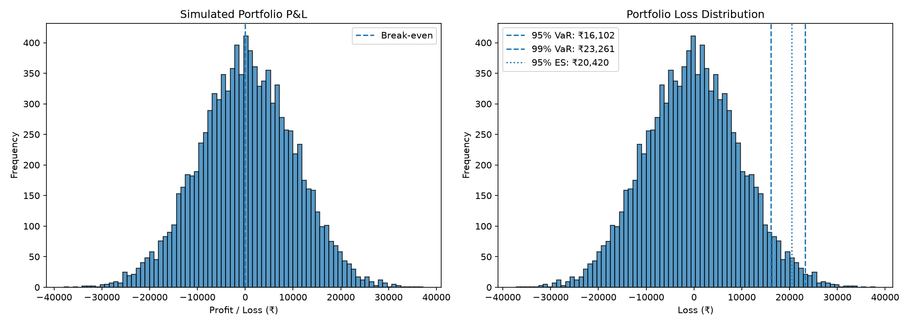

# Monte Carlo Portfolio Risk Simulator

A compact Python quantitative-finance project that simulates 10,000 correlated one-day asset-return scenarios and estimates portfolio Value at Risk (VaR), Expected Shortfall, and the effect of diversification.

## Features
- Reproducible Monte Carlo simulation of three correlated assets
- Portfolio return and P&L calculation
- 95% and 99% VaR
- 95% Expected Shortfall
- Concentrated-versus-diversified risk comparison
- P&L and loss-distribution charts
- CSV outputs for simulated returns and risk summary
- Automated tests with pytest

## Example results

Using the configured illustrative parameters, the initial run produced:

| Metric | Example result |
|---|---:|
| Portfolio value | ₹10,00,000 |
| Simulations | 10,000 |
| 95% VaR | ₹16,102.41 |
| 99% VaR | ₹23,261.08 |
| 95% Expected Shortfall | ₹20,420.39 |
| Asset A only 95% VaR | ₹20,695.38 |
| VaR reduction in this run | 22.19% |

These are example results from the configured model and random seed. Re-run the project to regenerate output files; values may change if assumptions or implementation change.

## Visualization

Run the project to generate `results/portfolio_risk.png`, then view it locally. To show the image in a GitHub README, keep the PNG tracked in the repository and use:



## Setup

Python 3.10+ is recommended.

```bash
python3 -m venv .venv
source .venv/bin/activate
python -m pip install -r requirements.txt
```

## Run

```bash
python main.py
```

The script prints risk metrics and creates:
- `results/portfolio_risk.png`
- `results/simulated_asset_returns.csv`
- `results/risk_summary.csv`

## Tests

```bash
python -m pytest -v
```

## Methodology and assumptions

The model uses a multivariate normal approximation for daily simple returns, illustrative expected returns/volatilities/correlations, fixed portfolio weights, and a one-day horizon. See [`docs/methodology.md`](docs/methodology.md) for formulas and limitations.

This is an educational simulation, not a calibrated forecast, investment recommendation, or guarantee of future losses.
